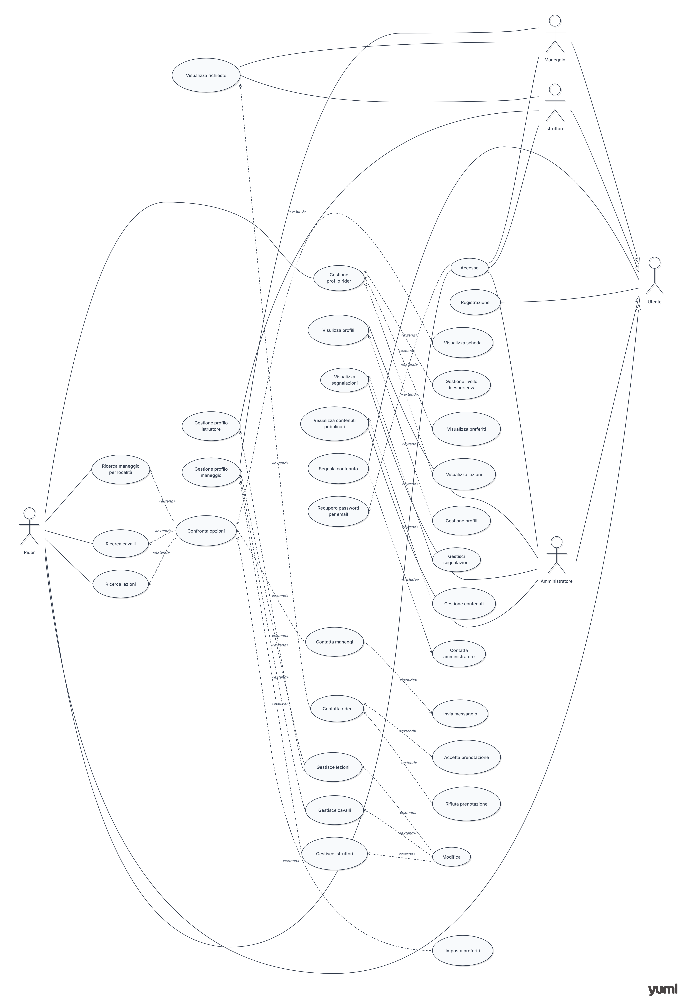
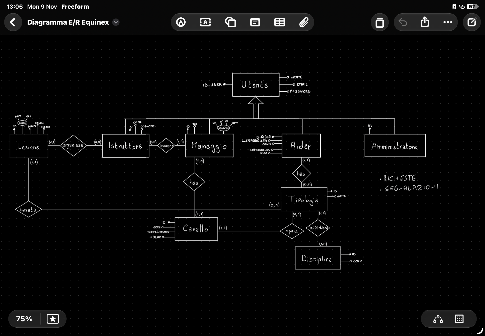

# Progetto individuale StartUp — EquiNex

*Where every Rider finds their perfect Equine connection.*

EquiNex è un'applicazione progettata per mettere in contatto cavalieri (*Rider*), maneggi e istruttori, aiutando gli utenti a trovare il cavallo, il centro equestre o la lezione più adatti alle proprie esigenze, al proprio livello di esperienza e ai propri obiettivi.

Il nome **EquiNex** richiama l'espressione *Equus Nexus*: *Equus* significa «cavallo», mentre *Nexus* richiama il concetto di «legame» o «connessione». L'unione dei due termini rappresenta la missione della piattaforma: creare un punto d'incontro tra il mondo equestre e le persone che ne fanno parte.

L'obiettivo è offrire un unico spazio in cui i Rider possano cercare e confrontare le opportunità disponibili, mentre i maneggi possano presentare le proprie strutture, pubblicare cavalli e lezioni, gestire le disponibilità e ricevere richieste dagli utenti.

## Indice

- [1. Obiettivi del progetto](#1-obiettivi-del-progetto)
- [2. Problema e soluzione proposta](#2-problema-e-soluzione-proposta)
- [3. Nicchia di mercato e utenti target](#3-nicchia-di-mercato-e-utenti-target)
- [4. Funzionalità dell'applicazione](#4-funzionalità-dellapplicazione)
- [5. Casi d'uso UML](#5-casi-duso-uml)
- [6. User Story](#6-user-story)
- [7. Requisiti non funzionali e di dominio](#7-requisiti-non-funzionali-e-di-dominio)
- [8. Analisi dei competitor](#8-analisi-dei-competitor)
- [9. Struttura del repository](#9-struttura-del-repository)

## 1. Obiettivi del progetto

EquiNex nasce con l'obiettivo di semplificare la ricerca di attività e servizi equestri attraverso una piattaforma che tenga conto delle caratteristiche e delle necessità di ogni Rider.

Gli obiettivi principali sono:

- Facilitare la ricerca di maneggi, cavalli e lezioni.
- Permettere di individuare attività compatibili con il livello di esperienza, le discipline praticate, le preferenze e le disponibilità.
- Offrire ai maneggi uno spazio per pubblicare e aggiornare le proprie offerte.
- Agevolare i contatti tra Rider e strutture equestri.
- Centralizzare le informazioni rilevanti per i profili.

## 2. Problema e soluzione proposta

La ricerca di un maneggio, di un cavallo o di una lezione può richiedere la consultazione di numerose fonti e il contatto diretto con diverse strutture.

EquiNex intende semplificare questo processo mettendo a disposizione funzionalità di ricerca, filtri e valutazione della compatibilità. In questo modo, il Rider può individuare più facilmente le opzioni che rispondono alle proprie esigenze, mentre il maneggio può gestire le proprie informazioni e ricevere richieste attraverso la piattaforma.

La proposta di valore si basa su tre elementi:

1. **Ricerca mirata:** individuare le opportunità in base a criteri specifici.
2. **Compatibilità:** confrontare le caratteristiche del Rider con quelle di cavalli, maneggi e lezioni.
3. **Connessione:** facilitare la comunicazione tra utenti e strutture equestri.

## 3. Nicchia di mercato e utenti target

La nicchia individuata per EquiNex è quella dei servizi digitali dedicati al mondo equestre, con particolare attenzione alla ricerca di attività e opportunità adatte alle esigenze dei cavalieri.

La seguente segmentazione rappresenta il target progettuale previsto, non una nicchia di mercato già validata tramite una ricerca di mercato.

| Target | Esigenza principale | Soluzione offerta |
|---|---|---|
| Rider principianti | Trovare cavalli e lezioni adatti alla propria esperienza | Filtri per livello e caratteristiche del cavallo |
| Rider intermedi ed esperti | Individuare attività e strutture coerenti con i propri obiettivi | Ricerca per disciplina, disponibilità e compatibilità |
| Maneggi e centri equestri | Far conoscere la propria struttura e le attività disponibili | Profilo della struttura e pubblicazione di cavalli e lezioni |
| Istruttori | Rendere visibili le proprie qualifiche e competenze | Gestione delle informazioni tramite il profilo del maneggio |

## 4. Funzionalità dell'applicazione

Le funzionalità elencate in questa sezione derivano dal documento dei requisiti del progetto. Rappresentano le funzionalità previste e non implicano che siano già tutte implementate.

### 4.1 Registrazione e gestione degli account

- Creazione di un account.
- Registrazione tramite nome, email e password.
- Scelta del tipo di account.
- Login e recupero della password.
- Modifica dei dati personali e della password.
- Gestione delle preferenze.
- Logout ed eliminazione dell'account.

### 4.2 Profilo Rider

- Inserimento e modifica dei dati personali.
- Indicazione del livello di esperienza: principiante, intermedio o esperto.
- Selezione delle discipline equestri di interesse.
- Inserimento di esigenze e preferenze.
- Gestione delle disponibilità.
- Caricamento e aggiornamento della documentazione pertinente.

### 4.3 Profilo Maneggio e gestione degli istruttori

- Inserimento e modifica dei dati della struttura.
- Gestione di indirizzo, posizione, descrizione e contatti.
- Indicazione delle discipline praticate.
- Gestione delle informazioni sugli istruttori e delle relative qualifiche.
- Caricamento della documentazione amministrativa e assicurativa.
- Gestione dell'eventuale affiliazione FISE.
- Gestione delle certificazioni e delle scadenze.

### 4.4 Ricerca dei maneggi

- Ricerca per località.
- Visualizzazione dei maneggi compatibili.
- Consultazione delle informazioni della struttura.
- Visualizzazione delle discipline offerte.
- Consultazione dei contatti.

### 4.5 Ricerca dei cavalli

- Visualizzazione dei cavalli disponibili.
- Filtri per livello di esperienza del Rider.
- Filtri per disciplina.
- Consultazione delle caratteristiche del cavallo.
- Valutazione della compatibilità tra Rider e cavallo.

### 4.6 Ricerca delle lezioni

- Visualizzazione delle lezioni disponibili.
- Ricerca per disciplina.
- Ricerca per livello richiesto.
- Ricerca per disponibilità.
- Consultazione dei dettagli delle lezioni.
- Verifica della compatibilità tra gli orari del Rider e quelli proposti.

### 4.7 Filtri e sistema di compatibilità

Il sistema di ricerca prevede filtri basati su:

- Livello di esperienza.
- Disciplina.
- Disponibilità.
- Località o distanza.
- Tipologia di lezione.
- Compatibilità con le esigenze del Rider.

Il sistema di compatibilità ha lo scopo di confrontare le caratteristiche del Rider con quelle dei maneggi, dei cavalli e delle lezioni, così da evidenziare le opzioni potenzialmente più adatte.

### 4.8 Preferiti e contatti

- Salvataggio dei maneggi preferiti.
- Salvataggio dei cavalli preferiti.
- Salvataggio delle lezioni preferite.
- Invio di richieste ai maneggi.
- Ricezione e gestione delle richieste da parte dei maneggi.
- Notifiche relative a richieste, contatti, modifiche e disponibilità.

### 4.9 Gestione delle pubblicazioni e delle disponibilità

I maneggi devono poter:

- Aggiungere, modificare ed eliminare i cavalli pubblicati.
- Creare, modificare ed eliminare le lezioni.
- Inserire e aggiornare gli orari disponibili.
- Mantenere aggiornate le informazioni pubblicate.

### 4.10 Segnalazioni e amministrazione

Le funzionalità amministrative previste comprendono:

- Gestione degli utenti e dei profili.
- Gestione dei maneggi.
- Controllo delle segnalazioni.
- Gestione dei contenuti pubblicati.

Gli utenti devono inoltre poter segnalare profili o contenuti non appropriati e informazioni errate.

## 5. Casi d'uso UML

I casi d'uso descrivono le interazioni tra gli attori e il sistema. Un caso d'uso comprende i possibili scenari relativi a una funzionalità, incluse le eventuali alternative e situazioni di errore.



### 5.1 Attori principali

| Attore | Responsabilità |
|---|---|
| Visitatore | Esplora le funzionalità pubbliche e può registrarsi |
| Rider | Gestisce il profilo, cerca maneggi, cavalli e lezioni, salva preferiti e invia richieste |
| Maneggio | Gestisce il profilo della struttura, gli istruttori, i cavalli, le lezioni e le disponibilità |
| Amministratore | Gestisce utenti, contenuti e segnalazioni |

L'istruttore è considerato nella gestione del profilo del maneggio, secondo le note presenti nel documento dei requisiti. L'eventuale definizione di un attore autonomo dovrà essere coerente con la scelta progettuale definitiva.

### 5.2 Principali casi d'uso

| ID | Caso d'uso | Attore principale |
|---|---|---|
| UC-01 | Registrare un account | Visitatore |
| UC-02 | Effettuare il login | Utente registrato |
| UC-03 | Recuperare la password | Utente registrato |
| UC-04 | Gestire il profilo Rider | Rider |
| UC-05 | Gestire il profilo del maneggio | Maneggio |
| UC-06 | Cercare maneggi | Rider |
| UC-07 | Cercare cavalli | Rider |
| UC-08 | Cercare lezioni | Rider |
| UC-09 | Filtrare e confrontare le opzioni | Rider |
| UC-10 | Visualizzare una scheda dettagliata | Rider |
| UC-11 | Gestire i preferiti | Rider |
| UC-12 | Inviare una richiesta a un maneggio | Rider |
| UC-13 | Gestire le richieste ricevute | Maneggio |
| UC-14 | Pubblicare e gestire cavalli e lezioni | Maneggio |
| UC-15 | Gestire le disponibilità | Maneggio |
| UC-16 | Caricare e aggiornare documenti | Rider / Maneggio |
| UC-17 | Gestire le notifiche | Utente registrato |
| UC-18 | Segnalare un contenuto | Utente registrato |
| UC-19 | Gestire utenti e contenuti | Amministratore |

L'elenco costituisce una sintesi iniziale. I singoli casi d'uso dovranno essere descritti in modo più dettagliato, indicando precondizioni, flusso principale, alternative e postcondizioni.

## 6. User Story

Le User Story sono brevi descrizioni delle funzionalità dell'applicazione dal punto di vista degli utenti. Permettono di comprendere chi utilizzerà una determinata funzionalità, cosa desidera fare e quale beneficio vuole ottenere.

Nel progetto EquiNex, ogni User Story segue una struttura standard:

**Come [entità], voglio [funzionalità], così da [obiettivo].**

### 6.1 Struttura di una User Story

Ogni User Story è composta da tre elementi:

| Elemento | Descrizione | Esempio |
|---|---|---|
| Entità | Identifica il soggetto che utilizza la funzionalità | Rider |
| Funzionalità | Descrive ciò che l'entità desidera fare | Cercare maneggi per località |
| Obiettivo | Spiega il motivo e il beneficio dell'azione | Trovare strutture vicine |

### 6.2 Entità coinvolte

Le entità rappresentano le diverse tipologie di utenti che interagiscono con EquiNex.

| Entità | Descrizione |
|---|---|
| Utente | Rappresenta un utente generico della piattaforma, indipendentemente dal ruolo. |
| Rider | È il cavaliere che utilizza l'applicazione per cercare maneggi, cavalli e lezioni compatibili con le proprie esigenze. |
| Maneggio | È la struttura equestre che gestisce il proprio profilo, pubblica cavalli e lezioni e riceve richieste dai Rider. |
| Amministratore | È il soggetto incaricato della gestione degli utenti, dei contenuti e delle segnalazioni. |

**Nota:** l'istruttore viene gestito attraverso il profilo del Maneggio e non costituisce un'entità autonoma per la gestione dell'account, secondo le indicazioni presenti nel documento dei requisiti.

### 6.3 Esempi di User Story

Di seguito alcuni esempi tratti dai requisiti funzionali del progetto.

**Utente**
- Come Utente, voglio creare un account, così da poter utilizzare EquiNex.
- Come Utente, voglio effettuare il login con email e password, così da accedere al mio account.
- Come Utente, voglio modificare i miei dati personali, così da mantenere aggiornato il mio account.

**Rider**
- Come Rider, voglio indicare il mio livello di esperienza, così da trovare attività adatte a me.
- Come Rider, voglio cercare maneggi per località, così da trovare strutture vicine o nella zona desiderata.
- Come Rider, voglio cercare i cavalli disponibili, così da trovare un cavallo adatto alle mie esigenze.
- Come Rider, voglio filtrare i risultati per disciplina, così da trovare le attività che mi interessano.
- Come Rider, voglio salvare i maneggi interessanti, così da poterli ritrovare facilmente.

**Maneggio**
- Come Maneggio, voglio inserire i dati della struttura, così da creare il mio profilo.
- Come Maneggio, voglio indicare le discipline praticate, così da mostrare le attività offerte.
- Come Maneggio, voglio pubblicare i cavalli disponibili, così da permettere ai Rider di trovarli.
- Come Maneggio, voglio pubblicare le lezioni disponibili, così da permettere ai Rider di trovarle.
- Come Maneggio, voglio gestire le mie disponibilità, così da mostrare ai Rider gli orari disponibili.

**Amministratore**
- Come Amministratore, voglio gestire i contenuti pubblicati, così da mantenere la qualità della piattaforma.

### 6.4 Collegamento tra User Story e requisiti

Le User Story sono collegate ai requisiti funzionali presenti nel documento Excel. Ogni requisito funzionale descrive una specifica funzionalità e, quando previsto, è accompagnato dalla relativa User Story.

Questa relazione permette di comprendere a quale esigenza dell'utente risponde ciascuna funzionalità e di mantenere un collegamento tra analisi dei requisiti, progettazione UML e sviluppo dell'applicazione.

### 6.5 Diagramma E/R



## 7. Requisiti non funzionali e di dominio

Oltre alle funzionalità visibili all'utente, EquiNex deve rispettare requisiti relativi alla sicurezza, all'affidabilità e alle caratteristiche specifiche del settore equestre.

### 7.1 Requisiti non funzionali

Tra i principali requisiti individuati nel documento figurano:

- **Sicurezza:** protezione degli account e gestione sicura delle credenziali.
- **Privacy:** protezione dei dati personali e limitazione dell'accesso ai documenti sensibili.
- **Affidabilità:** salvataggio corretto dei dati e mantenimento delle informazioni pubblicate.
- **Prestazioni:** restituzione dei risultati di ricerca in tempi brevi.
- **Usabilità:** interfaccia e filtri semplici da comprendere e utilizzare.
- **Aggiornamento:** disponibilità di informazioni coerenti con gli orari, le offerte e le scadenze effettive.

Questi requisiti dovranno essere verificati mediante controlli e test adeguati. Quando possibile, dovranno essere trasformati in criteri misurabili.

### 7.2 Requisiti di dominio

I requisiti di dominio dipendono dalle caratteristiche del settore equestre e dalle condizioni applicabili alle singole attività.

Tra gli aspetti considerati nel progetto:

- Classificazione del livello di esperienza del Rider.
- Discipline equestri offerte dai maneggi.
- Compatibilità tra cavallo e cavaliere.
- Requisiti di idoneità sportiva, quando richiesti.
- Documentazione amministrativa e assicurativa delle strutture.
- Qualifiche e certificazioni degli istruttori.
- Tesseramento e autorizzazioni FISE, quando pertinenti.

La documentazione necessaria può variare in base all'attività e alla situazione specifica. I requisiti del progetto non sostituiscono quindi la verifica delle norme e degli obblighi effettivamente applicabili.

## 8. Analisi dei competitor

EquiNex si propone di semplificare la ricerca di cavalli, maneggi, centri equestri e lezioni, distinguendosi dagli strumenti generalisti già utilizzati dagli utenti.

### 8.1 Google Maps e Google Search

Google Maps e Google Search permettono di trovare maneggi e centri equestri, consultare informazioni sulle strutture e individuare la loro posizione.

Questi strumenti rappresentano un'alternativa per la ricerca iniziale, ma EquiNex si concentra specificamente sul settore equestre, con l'obiettivo di permettere ai Rider di cercare e confrontare le opportunità in base alle proprie esigenze.

### 8.2 Social Network

I social network, come Instagram e Facebook, vengono utilizzati anche da maneggi, istruttori e cavalieri per condividere informazioni, pubblicare contenuti e mantenersi in contatto.

EquiNex si differenzia perché nasce con uno scopo specifico: organizzare le informazioni relative a maneggi, cavalli e lezioni, facilitando la ricerca attraverso filtri dedicati e criteri di compatibilità.

### 8.3 Elementi distintivi di EquiNex

Rispetto a questi strumenti, EquiNex punta a offrire:

- **Ricerca specializzata:** maneggi, cavalli e lezioni in un'unica piattaforma.
- **Filtri mirati:** ricerca in base a livello di esperienza, disciplina e disponibilità.
- **Compatibilità:** individuazione delle opportunità più adatte alle esigenze del Rider.
- **Informazioni organizzate:** consultazione delle caratteristiche delle strutture, dei cavalli e delle lezioni.
- **Contatti diretti:** possibilità di inviare e gestire richieste tra Rider e maneggi.

L'obiettivo è ridurre la necessità di consultare fonti diverse e rendere la ricerca di opportunità equestri più semplice e mirata.

## 9. Struttura del repository

```text
EquiNex/
├── README.md
├── image/
│   └── Elenco completo delle funzionalità e requisiti.png
└── Elenco completo delle funzionalità e requisiti.xlsx
